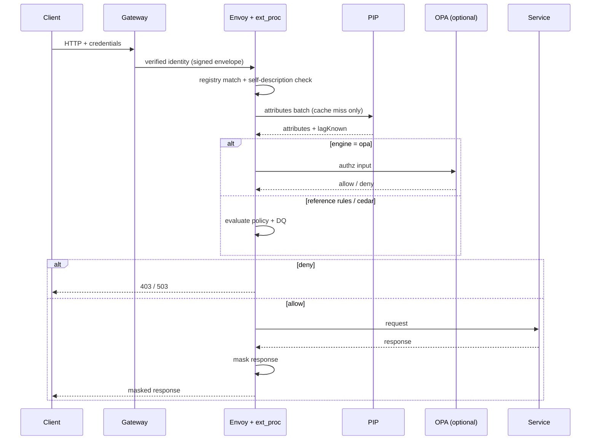
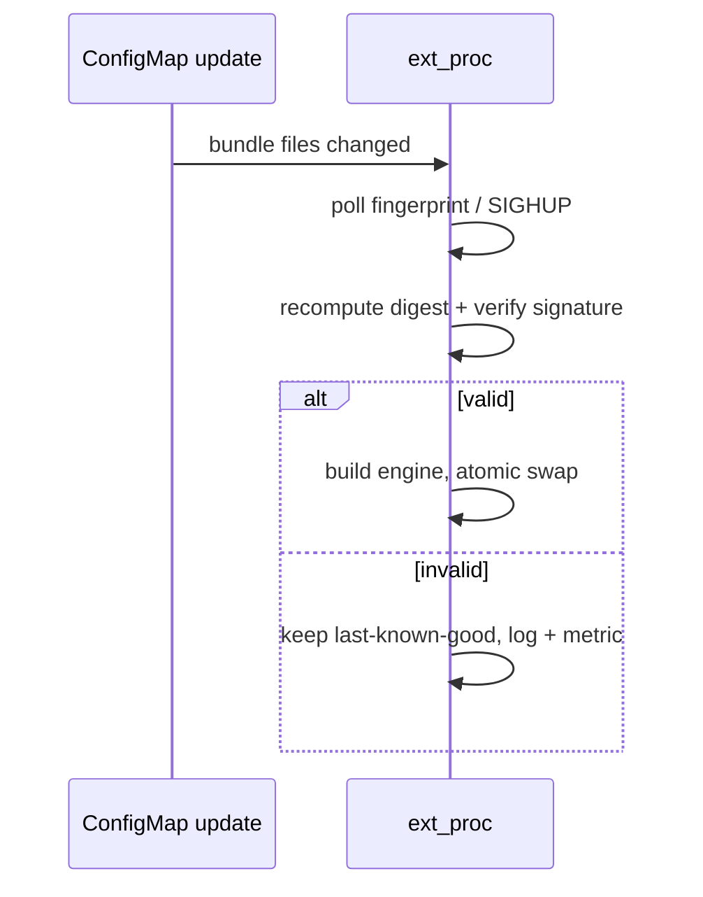
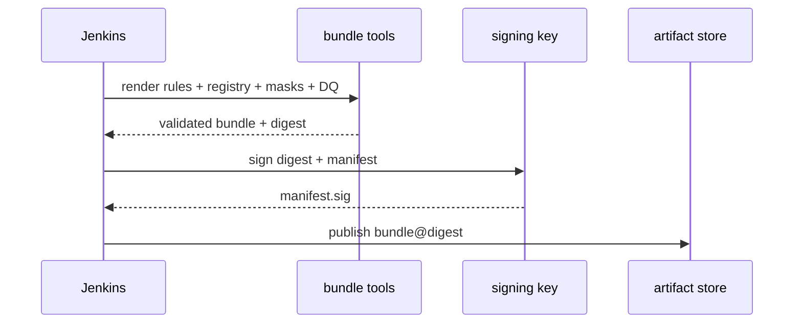
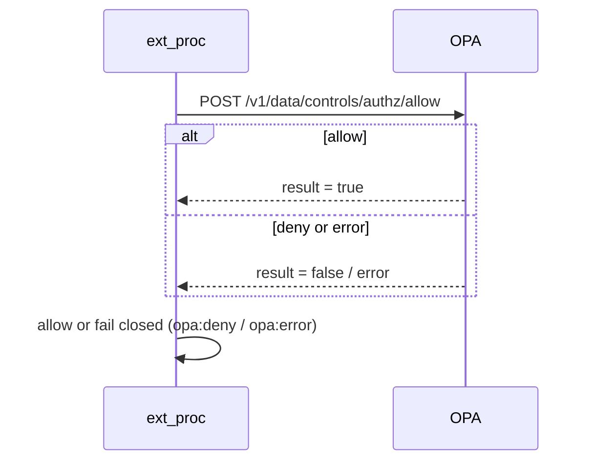

# Architecture

Status: reference implementation `v0.38.3`.

## 1. Context and constraints

| Constraint | Value | Consequence |
|---|---|---|
| Traffic | north–south, 5,000 RPS | one edge enforcement point; no mesh required |
| Pods | ≤ 5 | ~1,000 RPS/pod; sidecar restarts cost 20% capacity |
| Payload | 2 KB typical, 4 KB p99 | full body buffering is cheap; no streaming |
| Latency budget | p99 1 s end to end | controls must stay under ~3–5 ms p99 |
| Fleet | JVM-only, but centrally managed | sidecar keeps policy/engine out of app releases |
| Entitlements | request-level (gateway) + data-level (payload + DB state) | data-level must run where payload and PIP meet |

## 2. Components

```
                     ┌────────────────────────────── control plane ─────────────────────────────┐
                     │ PIP HTTP API (2+ replicas) · read replicas · classification cache        │
                     │ bundle/config distribution · decision log pipeline                       │
                     └──────────────────────────────────────────────────────────────────────────┘
 client ─▶ gateway ─▶ ┌─ Envoy sidecar (per pod) ─────────────┐ ─▶ Spring Boot service
          (authn +    │ ext_authz  coarse/defence-in-depth     │
           coarse     │ ext_proc   request  → registry         │
           authz)     │            → PIP (cached)              │
                      │            → policy eval → DQ          │
                      │            response → mask             │
                      └───────────────────────────────────────┘
```

| Component | Code | Responsibility |
|---|---|---|
| Engine | `internal/engine` | Orchestrates match → identity → attributes → decision → DQ → masking |
| Registry | `internal/config` | Route binding, identity extraction, authority rule |
| Policy | `internal/policy` | Selectable evaluator: reference rules, Cedar, or external OPA; deny-first |
| Masking | `internal/mask` | Full/partial field masking, array paths, locked fields |
| DQ | `internal/dq` | Multi-state validation; blocking only when configured |
| PIP client | `internal/pipclient` | HTTP, projection, TTL cache, coalescing, breaker, fail-closed |
| PIP server | `pip/server` | Batch/classification API over a read-only Repository (fixtures or HTTP attribute APIs) |
| ext_proc adapter | `sidecar/extproc` | Envoy transport: header extraction, buffering, immediate responses, body mutation |
| Harness | `sidecar/cmd/sidecar` | HTTP harness used locally and in integration tests |
| Audit | `internal/audit` | Hashed, sampled decision log per the contract |
| Metrics | `internal/metrics` | Prometheus counters/histograms/gauges on the admin port |
| Bundle renderer | `internal/bundle`, `tools/bundle` | Merge sources/overlays into a validated, digest-bearing bundle |
| Conformance | `internal/conformance`, `tools/conformance` | Execute delivery fixtures against a rendered bundle |
| OpenAPI gate | `internal/openapidiff`, `tools/openapi-diff` | Registry ↔ OpenAPI coverage check |
| Registry generator | `internal/openapiregistry`, `tools/openapi-registry` | Derive registry entries from `x-resource-*` annotations |
| Controls check | `internal/controlscheck`, `tools/controls-check` | Rules/DQ/masks/attributes vs registry and OpenAPI schemas |
| Sidecar runtime | `deploy/sidecar` | Combined Envoy + extproc sample image |
| Sidecar Helm library | `deploy/helm/controls-sidecar` | Inject the two containers into service pods |
| Pipeline integration | `ci/Jenkinsfile`, `docs/PIPELINE.md` | Contract for the centrally managed Jenkins job |
| Benchmark | `integration/bench_test.go` | Decision/mask overhead regression signal |

### Artifacts

- **Bundle**: `registry.json`, `rules.json`, `mask-policies.json`, `dq.json`,
  `manifest.json`, optional `policies.cedar`, `manifest.sig`.
- **Contracts**: registry/mask schemas, PIP OpenAPI, decision-log schema,
  test-API contract (`contracts/`).
- **Runtime**: sidecar image, PIP image, rendered bundle; the service image is
  unchanged.
- **Pipeline outputs**: signed bundle and digest; deployment pins the digest.

## 3. Request flow

1. **Gateway** authenticates, authorizes the route/scope, and injects verified
   identity. With `CONTROLS_IDENTITY_HMAC_KEY` set, the sidecar requires the
   signed `x-controls-identity` envelope; raw `x-subject`/`x-claim-*` are a
   development fallback only.
2. **Registry match.** No match ⇒ `defaultUnregistered` (production: deny).
3. **Self-description cross-check.** With `selfDescribing`, payload `_type`
   must equal the registry `resourceType` and `_id` must equal the derived
   identifier. Mismatch ⇒ 403. *The route is the authority, not the payload.*
4. **Resource identity** from path parameter or body JSON path.
5. **Rejected fields.** Write policies reject fields such as `pan`/`cvv`.
6. **Resource attributes.** `resourceSource` selects body, PIP, or both. PIP
   calls request only the registry's `attributes` projection. `freshness`
   controls cache bypass and the replica-lag bound (`maxStalenessSeconds`,
   default 5s). Missing lag (`lagKnown: false`) is `503 lag_unknown`; exceeding
   the bound is `503 stale_attributes`.
7. **Policy.** The bundle selects `rules` (deny rules absolute, allow rules
   OR-ed, default deny), `cedar` (entity evaluation, deny by default), or `opa`
   (external decision API, fail closed).
8. **DQ.** Violations are recorded; only `blocking: true` rejects.
9. **Response.** The matched endpoint's mask policy is applied to JSON
   responses, including errors when `maskErrors` is true.

### 3.1 Request sequence



### 3.2 Reload and signing sequences





## 4. Latency and capacity budget

At 1,000 RPS/pod with 4 KB p99:

| Step | p99 (est.) | Notes |
|---|---|---|
| ext_proc buffered round trip | 0.3–1.0 ms | body copied once |
| registry + policy eval | 0.05–0.2 ms | in-process, no I/O |
| PIP cache hit | ~0.1 ms | Caffeine-style local cache |
| PIP cache miss | 2–5 ms | HTTP + replica query |
| masking (4 KB) | 0.05–0.15 ms | parse + mutate + serialize |
| **Total, cache hit** | **< 1.5 ms** | well inside budget |
| **Total, cache miss** | **< 7 ms** | still <1% of p99 |

CPU: roughly 0.1–0.3 vCPU per 1,000 RPS for the sidecar. At 5 pods, budget ~2
vCPU and ~250 MB across the fleet for controls.

End-to-end (Apple M2, Envoy 1.40, 15 s, 1,200 target RPS): 1,194 RPS, p50 1.0 ms,
p95 2.1 ms, p99 6.0 ms, 0 errors (single host; `TESTING.md`).

Measured engine-only (Apple M2, Go 1.27, `make bench`): ~7 µs per decision
without PIP, ~1.5 µs per read on a warm cache, ~11 µs to mask a 4 KB document.
These exclude the Envoy ext_proc hop (~0.3–1 ms), which is the dominant term.
The regression gate is the benchmark trend plus the p99 budget above.

Cache requirements: hit rate >95% steady state; miss storm protection via
per-key coalescing; TTL 30–60 s for attributes, hours for classification. The
cache is keyed by type, id and field projection.

### 4.1 Capacity and HA

Assumptions: 5,000 RPS, >95% cache hit, ~5% cache-miss QPS.

| Item | Sizing |
|---|---|
| PIP requests | ~250 RPS at steady state, ~5,000 RPS worst case if the cache is cold |
| PIP replicas | 2+ (N+1); ~125 RPS each at steady state, 2x headroom |
| Source read APIs | ≥250 RPS aggregate; per-domain replicas own their own capacity |
| Sidecar CPU | ~0.1–0.3 vCPU per 1,000 RPS; ~1.5 vCPU across five pods |
| Sidecar memory | ~250 MB across the fleet (excluding Envoy buffers) |
| PIP memory | cache + connection pools; keep bounded, evict expired entries |

- **Zones:** spread PIP replicas across zones; prefer local read APIs.
- **Disruption:** PDB `minAvailable: 1`; rolling updates one pod at a time.
- **Backpressure:** PIP `-max-concurrent` and per-caller `-rate-limit`; sidecar
  breaker and cache coalescing.
- **Scaling:** HPA on PIP CPU/RPS; sidecar scales with the service pods.
- **Degradation:** cache hit-rate drop is the first signal; page on PIP latency,
  error rate and lag, not just availability.

## 5. Failure behaviour

| Failure | Behaviour |
|---|---|
| PIP timeout / unavailable | **Deny** (503 `pip_unavailable`) — fail closed |
| PIP lag unknown | **Deny** (503 `lag_unknown`) for `fresh`/`deny-on-stale` |
| OPA unavailable or error | **Deny** (`opa:error`) — fail closed |
| PIP resource not found | 404 `resource_not_found` |
| Invalid bundle at boot | Pod does not become ready |
| Invalid bundle on reload | Keep last-known-good, alert |
| Policy bundle missing/corrupt | Deny on next start; never run partially configured |
| Mask policy missing at runtime | Request fails closed (gRPC error → 500); never returns unmasked |
| Unregistered route | Deny (`defaultUnregistered: deny`) |
| DQ violation, non-blocking | Allow; log + metric |
| DQ violation, blocking | 403 `dq_blocking:<rule>` |

## 6. Deployment

- **Sidecar**: one image, injected into all 5 service pods. `maxUnavailable: 1`.
  Upgrades are rolling pod restarts; no application rebuild.
- **PIP**: 2+ replicas behind a Service, mTLS. Production uses the HTTP
  attribute-source adapter (`-sources`) against per-domain read APIs; those
  APIs own replica credentials and query shape. Size for cache-miss QPS
  (~5% of 5,000 = 250 RPS).
- **Observability**: ext_proc exposes `/metrics`, `/healthz` and `/readyz` on
  `:9090`; decision logs are hashed JSON on stdout or `-audit-out <file>`.
  Scrape the admin port and ship the audit stream to the platform log store.
- **Bundle integrity**: the sidecar verifies `manifest.sig` against the
  recomputed digest when `-bundle-pubkey` is set, and refuses to start when the
  bundle is modified or unsigned. `-allow-unsigned` is a development-only
  escape.
- **Reload**: the bundle directory is polled every 30s (configurable) and
  `SIGHUP` forces a reload. Each reload re-verifies the signature, rebuilds the
  engine and atomically swaps it; failures keep the last-known-good bundle.
- **Deployment controls**: the Helm chart
  ([`deploy/helm/controls-plane`](deploy/helm/controls-plane)) deploys the PIP
  with NetworkPolicies (gateway → sidecar, sidecar → PIP, monitoring → metrics)
  and optional Istio `PeerAuthentication: STRICT` plus a PIP
  `AuthorizationPolicy` limited to sidecar service accounts. The
  [`controls-sidecar`](deploy/helm/controls-sidecar) library chart injects the
  Envoy/extproc containers; `deploy/sidecar` packages them for samples.
- **Bundle**: rendered by the delivery pipeline, signed, digest-pinned, mounted
  as a ConfigMap/volume. Sidecar records the bundle digest in the decision log.

### 6.1 Trust boundaries

```
client ── untrusted ──▶ gateway ── verified ──▶ sidecar ── mTLS ──▶ PIP ──▶ replicas
                          │                      │
                          │                      └── signed bundle + audit
                          └── authentication / route authz
```

- The gateway is the only component that authenticates users and injects
  identity.
- The sidecar trusts the signed identity envelope, not client headers.
- The PIP trusts sidecar client certificates and enforces caller/field
  authorization.
- Replicas are read-only; credentials stay with the domain read API, not the
  sidecar.
- See [`SECURITY.md`](SECURITY.md) for the threat model and controls.

## 7. ext_proc adapter

Implemented in `sidecar/extproc`; Envoy configuration lives in
[`sidecar/envoy/`](sidecar/envoy/README.md).

- One gRPC stream per HTTP request. `request_body_mode` and
  `response_body_mode` are `BUFFERED`; the adapter tolerates chunked bodies but
  is optimised for the single-message case.
- Request phase: collect `:method`, `:path`, identity headers and body; call
  `engine.ProcessRequest`; send an `ImmediateResponse` (403/404/503) or continue.
- Response phase: collect the body; call `engine.MaskResponse`; return a body
  mutation when the output changed, otherwise continue.
- `failure_mode_allow: false` in Envoy, so an adapter outage fails closed.
- Pseudo-headers (`:method`, `:path`, `:status`) arrive as `raw_value`; the
  adapter reads both forms.
- A masked body changes length, so the adapter sets `content-length` (as
  `raw_value`) in the same response. Envoy requires
  `allow_content_length_header: true` (Envoy 1.40+).
- Bodies are capped at `-max-body-bytes` (default 1 MiB). Oversize request bodies
  get 413; an oversize response that requires masking gets 500 rather than
  leaking unmasked data.
- Compression is stripped for JSON routes; SSE/streaming routes must be excluded
  and audited.
- `ext_authz` remains available for coarse checks but is expected to be a no-op
  while the gateway owns route authz.

### 8.1 Alternatives considered

| Decision | Chosen | Alternative | Why |
|---|---|---|---|
| Enforcement point | Sidecar | In-app starter | No application changes; central upgrade and policy |
| Transport | Envoy `ext_proc` | `ext_authz` | Body buffering and response mutation are required for masking |
| Attribute source | PIP data service | Direct DB access from sidecar | Keeps DB credentials and schema ownership in the domain |
| Default policy engine | Reference JSON rules | Cedar/OPA only | Fast, dependency-free default; opt-in engines for complex policy |
| Repository split | Core + rules | One monorepo | Different owners, review and release cadence |
| Deployment | Helm render + `kubectl apply` | Helm release state | No release state; archived manifests for rollback |
| DQ | In-process JSON rules | Rego/OPA | Field validation is hot-path and load-validated |

See [`docs/PIPELINE.md`](docs/PIPELINE.md), [`docs/COMPATIBILITY.md`](docs/COMPATIBILITY.md)
and [`docs/adr/`](docs/adr/) for pipeline, versioning and decision records.

### 7.1 OPA sequence



## 8. Known gaps

| Gap | Impact | Plan |
|---|---|---|
| Envoy 1.40+ required | `allow_content_length_header` is unavailable in older images | Pin the image and smoke-test on upgrade |
| PIP lag must be reported by adapters | Missing lag now fails closed (`lag_unknown`), but end-to-end measurement/alerting is not built | Adapter contract test + lag alerting |
| Classification tag completeness | Untagged sensitive fields are not masked by the fallback | Catalog review + classification coverage check before pilot |
| OPA policies live outside the signed bundle | Policy changes are not covered by bundle signing | Keep OPA under its own change control, or move rules into the bundle |
| Jenkins job adoption | Reference jobs and tools image exist; the central team must adopt them | Hand over `docs/PIPELINE.md` and the image digest |
| Audit sink/retention unmanaged by core | Platform must ship the audit stream and enforce retention | Hand over scrape/log config with the pilot |
| Gateway signer not deployed | Raw-header fallback remains possible | Deploy the signer and enforce `CONTROLS_IDENTITY_HMAC_KEY` |
| Base images and tools digest placeholder | Builds are not fully reproducible | Pin Go/Alpine by digest; replace the Jenkins tools digest |
| PIP enforcement defaults are opt-in | mTLS, caller checks and rate limits are off unless configured | Set `pip.tls.required`, `requireCaller`, `allowedCallers` and limits in production |
